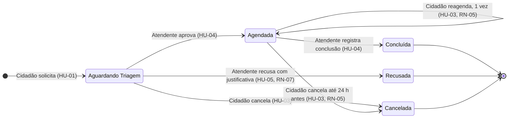
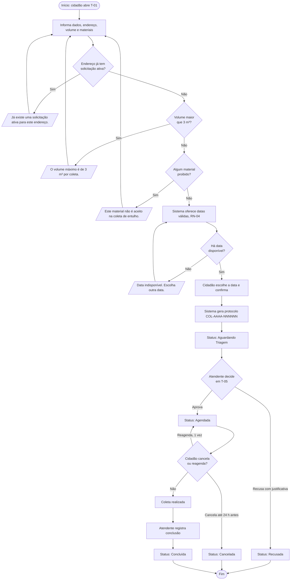

# 05. Processo

## Estados da solicitação

Cinco status. Concluída, Recusada e Cancelada são finais.

| De | Para | Quem | Condição |
|----|------|------|----------|
| (início) | Aguardando Triagem | Cidadão | Passou em RN-01, RN-02, RN-03 e RN-04; protocolo gerado (RN-06) |
| Aguardando Triagem | Agendada | Atendente | Aprovação |
| Aguardando Triagem | Recusada | Atendente | Justificativa com 10 ou mais caracteres (RN-07) |
| Aguardando Triagem | Cancelada | Cidadão | Sem prazo mínimo |
| Agendada | Agendada | Cidadão | Nova data válida (RN-04), até 24 h antes, no máximo 1 vez (RN-05) |
| Agendada | Cancelada | Cidadão | Até 24 h antes da coleta (RN-05) |
| Agendada | Concluída | Atendente | Coleta realizada |

Solicitações ativas (Aguardando Triagem e Agendada) ocupam o endereço (RN-01) e uma vaga na data (RN-04).

## Fluxo da solicitação

Da perspectiva do cidadão, da tela T-01 até a decisão do atendente.

## Telas por etapa

| Etapa | Tela |
|-------|------|
| Solicitar | T-01 Solicitar |
| Acompanhar | T-02 Acompanhar |
| Cancelar ou reagendar | T-03 Cancelar/Reagendar |
| Fila de triagem | T-04 Fila do atendente |
| Decisão (aprovar, recusar, concluir) | T-05 Detalhe e decisão |
| Consulta aberta ao público | T-06 Consulta pública |
